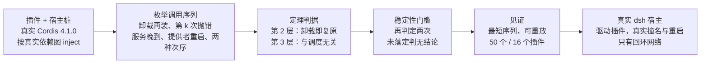

# dsh 热门插件的生命周期问题：cordis-check 报告

2026-11-25，11-26 补"模板之外的序列"

## 摘要

我们做了一个检查工具 cordis-check，把 npm 上下载量最高的 26 个第三方 dsh 插件放在真实的 Cordis 上运行，自动找出违反汇总定理的最短调用序列。它在 16 个插件上找到 50 个见证，每个都能重放复现。各类见证都拿到真实的 dsh 宿主 (发布版 0.2.2-rc.5) 上，用真实的触发方式检查过。主要问题全部复现，3 处判为桩造成的误报。

固定场景之外，我们又读插件源码，提出 5 组枚举模板表达不了的组合 (服务交接、故障后重启、连续重启、事件分发、非默认配置)，在 checker 上判定后全部拿到真实宿主上复现。其中两组是新问题。

主要发现：

- **一次路由撞名，插件就再也装不回去。** dshmarket、dsh-remote、dsh-whale-widget、dsh-connect-workbuddy、dsh-qqbot 都是先登记一批路由，最后才统一登记撤销。中途一次登记失败，前面的路由就泄漏：插件卸载后，它们仍由旧实例应答；再装时，插件撞在自己留下的路由上，直到宿主重启。5 个插件在真实宿主上全部复现。
- **两个插件正常卸载就泄漏。** dsh-windows-mcp 丢弃了 6 个路由登记的返回值；dsh-mobile-plugin 给每个路径挂的分派器在卸载时从不撤销，留下 286 条路由和 2 条升级路由。停用后这些路由仍由旧实例应答，再启用时新实例全部撞名，没有任何报错。两者都在真实宿主上复现。
- **服务重启一次，功能就静默消失。** dsh-free-search 在 systemPrompt 重启后只剩一个空壳 fiber (15 个缩成 1 个)，设置接口和工具全部消失；dsh-token-diet、ds-harness-remote 在 webServer 重启后丢掉 RPC 路由；dsh-remote 在 skills 重启后丢掉远端 skill provider。所有 fiber 仍是 ACTIVE，不报错，只有重启插件才恢复。全部在真实宿主上复现。
- **dsh-free-search 会把设置写入接口让给别的插件。** 撞名时它吞掉错误并"复用"已有登记，于是 `/mutate` 由占住这条路径的插件应答，它自己毫无察觉。
- **8 个插件卸载后留下进程级状态**：dns 解析序、`globalThis` 上的槽、`process` 监听器。dsh-prime-memory 的 `beforeExit` 监听器每重装一次就多一个，它 inject 的任一服务每重启一次也多一个：真实宿主上 webServer、tools 各重启三次，从 1 个涨到 7 个。7 个插件在真实宿主上复现。
- **两个插件争同一个服务名 `dshRemote`**，输的一方只打一条警告就继续运行。冲突在真实宿主上复现。checker 预测的"结果依赖安装次序"没有出现，因为异步延迟让 dsh-remote 总是赢。更直接的后果是：停用赢家之后，`dshRemote` 就无人提供，仍在运行的另一个插件不会接手，直到它自己重启 (新)。
- **中途失败之后重启服务，插件反而一条路由都不剩 (新)。** A 类的 5 个插件撞名失败后，重启 webServer 确实清掉了泄漏的路由，但失败的 fiber 不会随服务重新出现而重跑：插件的路由从 1 条泄漏变成 0 条，表上只留一条早已过时的撞名错误。只有重启插件本身才恢复。

这些问题集中在少数几种写法上，正好对应定理的几条前提：先做效应、后登记逆 (R1)；apply 时读一次没有 inject 的服务 (C2)；服务名与路由撞名时不拒绝 (R3)。宿主侧两处改动就能消除第一类问题的根源，见"建议"。

代码与全部见证在本目录 (`checker/`)，一次完整检查约 10 分钟。逐插件的细节与真实宿主上的逐步记录见 [FINDINGS.md](FINDINGS.md)。

## 背景

dsh (DeepSeek Harness) 的插件运行在 Cordis 之上。cordis-rocq 在 Rocq 中形式化了 Cordis 的生命周期演算，并证明了一个汇总定理 (`theories/Summary.v`)：只要服务与插件满足相应的前提，就有下面四层保证。

| 层 | 保证 | 插件侧的前提 (节选) |
| --- | --- | --- |
| 0 安全 | 良构，提供者比依赖者活得久 | 不猴补服务、不动进程全局、不挂到别人的 ctx 上 (S1–S3) |
| 1 活性 | 生命周期步终止，静止即稳定 | 启动程序有界，依赖无环 (L1–L2) |
| 2 恢复 | 卸载后的状态与从未安装不可区分 | 每个效应都登记在 fiber 上，中途抛错也不例外；登记名不撞 (R1–R4) |
| 3 合流 | 干净终态与调度无关，并等于静态组装 | 启动分支不依赖调度，逆与状态无关 (C1–C5) |

此前我们对这 26 个插件做过一轮人工审计 ([../docs/PLUGIN-AUDIT.md](../docs/PLUGIN-AUDIT.md))，只读源码，逐条判定每个前提。审计给出的是判定，而不是能拿给插件作者看的反例。这次的目标是：对每个问题，给出一条具体的、可重放的调用序列，并在真实宿主上确认它的后果。

## 方法

cordis-check 做具体执行加有界枚举，属于欠近似：报出的问题 (相对于宿主桩) 一定真实存在，没报的不等于没有。它与 Rocq 侧的证明互补：证明说满足前提就有保证，checker 找出不满足前提的真实插件会在哪里出事。



**运行环境。** 用 dsh 自己 vendored 的 Cordis (4.1.0)。宿主服务用桩代替，只模拟登记语义，照 dsh 源码写；webServer、tools、systemPrompt、settings、credentials、connection、loader 有专门的桩，其余 40 多个用通用桩。插件的 ESM `import` 与 CJS `require` 都经同一套映射，缺失的包换成桩。最要紧的是区分两种登记方式：

- **owned**：宿主经调用者的 `ctx.effect` 登记，卸载时自动撤销，如 `tools.register`。
- **bare**：宿主只返回一个裸 disposer，不归任何 fiber，如 `webServer.register`。插件不自己登记它的逆，就会泄漏。

宿主桩之间按真实宿主的服务依赖图声明 inject。依赖图由驱动插件从 dsh 0.2.2-rc.5 读出 (106 个服务，`lib/host-graph.json`)，例如 `tools` 依赖 `systemPrompt`，`webServer` 依赖 `webStartup`。这样撤走一个服务时，Cordis 会像真实宿主一样，连带卸载依赖它的宿主服务和插件。

**动作与演算规则。** 每条调用序列都由演算中的动作组成：

| 动作 | 演算规则 |
| --- | --- |
| `install(p)` / `dispose(p)` | O-Insert / O-Dispose |
| 服务出现 / 撤走 | 提供者的 O-Insert / O-Dispose (沿依赖图级联) |
| 第 k 次宿主调用抛错 | apply 在第 k 个 L-Step 处 L-Fail |

**五种场景与判据。**

1. 装上、卸载、再装：卸载后应与从未安装相同，再装应与第一次装上相同 (第 2 层)。
2. 故障注入：插件在 apply 中调用的每个宿主方法、每个 k，让第 k 次调用抛错，再卸载、再装 (R1)。
3. 服务晚到：每个宿主服务分别在插件之后才出现，落定状态应与服务先到时相同 (C2)。
4. 提供者重启：插件装上后，每个宿主服务分别撤走再提供，落定状态应与重启前相同 (C2)。服务实例被卸载时清空它名下的登记表，与真实宿主里新实例从空表开始一致。
5. 安装次序：两个插件两种安装次序，落定状态应相同 (合流、R3)。

比较的是一份规范化的快照：宿主桩上的登记表、Cordis 的服务归属与监听器次序、fiber 状态、进程级状态 (`globalThis` 的自有键、`process` 监听器、dns 解析序、长命句柄)。令牌与 fiber 编号不进快照，对应 `Observe.v` 中的 ≃。

**防误报。**

- 每个候选见证再判定两次，三次差异一致才保留。
- 快照前每步最多等 2 秒，让 fiber 走出 LOADING；仍未落定时，依赖时序的比较判无结论。
- 再装时用新的安装编号，把旧实例留下的东西和新实例的登记分开。
- 每条序列在单独的进程里跑，网络、子进程、`process.kill` 一律拦下。

**真实宿主复现。** 用 npm 发布版 dsh 0.2.2-rc.5，把插件和一个驱动插件装进全新的 profile。驱动插件通过 loader 停用、启用插件与服务提供者，发真实的 HTTP 请求，按处理器函数的身份区分新旧实例，并在宿主进程里读进程级状态。它不打补丁：需要故障时，先占住插件要登记的一条路由或一个提示段名；需要服务晚到或重启时，停用再启用提供它的 loader 条目。宿主跑在只有回环接口的网络命名空间里。工具与场景见 [real/](real/)。

**模板之外的序列。** 五种场景都只含单一动作，组合 (例如故障之后再重启服务) 与事件分发、非默认配置都不在枚举里。这一部分改为读插件源码与定理前提，先写下预测，再把序列交给 checker 执行，判据与稳定性门槛不变 ([beyond.mjs](beyond.mjs))，最后在真实宿主上复现。序列只用演算里的动作：install、dispose、provide、withdraw、fault、emit，外加条目配置。这一步由 LLM 完成，但提出时已经读过本报告，所以它示范的是这条路线可行，而不是度量 LLM 能独立找到多少问题。

## 结果总览

26 个插件中 25 个能在 checker 里装上，dsh-archive-manager 在 dsh 的存储校验上失败。装上的 25 个中，22 个全部 fiber ACTIVE；dsh-cost-meter 有一个 fiber 失败在 typert 的通用桩上，dsh-free-search 有一个按设计等 `connection.authentication`；dsh-mnemon 配置校验失败，没有 ACTIVE 的 fiber。

50 个见证按类别分布如下。

| 类别 | 层 | 见证 | 插件 | 真实宿主 |
| --- | --- | --- | --- | --- |
| A. 中途抛错后已登记的部分泄漏 | 2 (R1) | 13 | dsh-whale-widget、dshmarket、dsh-remote、dsh-connect-workbuddy、dsh-qqbot、dsh-windows-mcp、dsh-mobile-plugin、dsh-free-search、dsh-ops | 路由泄漏 5 个插件复现；free-search 不泄漏，但让出路由 (R3)；dsh-ops 的提示段复现 |
| A′. 不注入故障，正常卸载就残留路由 | 2 (R1) | 2 | dsh-windows-mcp、dsh-mobile-plugin | 都复现 |
| B. 卸载后进程级状态未恢复 | 0 (S3) / 2 (R2、R4) | 19 | dsh-whale-widget、dsh-session-superagent、dsh-cost-meter、ds-harness-remote、dsh-pet、dsh-prime-memory、dsh-im、dsh-mobile-plugin | 7 个复现；dsh-pet 的计时器不复现 |
| C. 结果依赖服务的时机或安装次序 | 3 (C2、R3) | 16 | dsh-free-search、dshmarket、dsh-token-diet、ds-harness-remote、dsh-remote、dsh-mobile-plugin；ds-harness-remote + dsh-remote | 6 个插件都确认 (free-search 在 systemPrompt 与 webStartup 上确认)；dsh-mobile-plugin 的 2 个重启见证与 `dshRemote` 的次序依赖未复现 |

B 类的 19 个见证中，11 个来自 dsh-prime-memory 同一个 `beforeExit` 监听器在每次重装或重启后累积。dsh-mobile-plugin 的 B 类残留在 A′ 的见证里一并出现，没有单独的见证。

完整的逐插件报告与见证 JSON 在 [reports/](reports/) 与 [witnesses/](witnesses/)，每个见证可用 `sh check.sh replay` 重放。

## A 类：一次撞名，插件就再也装不回去

dsh 的 `webServer.register` 只返回一个裸 disposer，撞名时抛错。这些插件的共同写法是：先按顺序登记一批路由，把返回值收进数组，最后才用一个 `ctx.effect` 登记"全部撤销"。第 k 条一旦抛错，前 k−1 条就没有人负责撤销了。

checker 的最短序列只有四步：

1. 第 k 次 `webServer.register` 抛错 (L-Fail)
2. `install(p)` (O-Insert)：内层 fiber 失败，前 k−1 条路由已登记
3. `dispose(p)` (O-Dispose)：这 k−1 条路由仍在，由旧实例的处理器应答
4. 再 `install(p)`：第一条路由就撞名，直到宿主重启都装不回去

| 插件 | 登记方式 (源码位置) | checker：有残留的故障点 / 最多残留 | 真实宿主 |
| --- | --- | --- | --- |
| dshmarket 1.80.0 | 63 条写在一个数组字面量里 (`lib/routes.js:3271`) | 62/63，62 条 | 复现 |
| dsh-remote 1.3.1 | `guarded.map(route => …register(route))` (`lib/http-transport.js:171`) | 43/44，43 条 | 复现 |
| dsh-whale-widget 0.4.2 | `disposers.push(registerRoute(…))` ×26 (`lib/index.js:895`) | 25/26，25 条；`tapIndex` 抛错时 26 条 | 复现 |
| dsh-connect-workbuddy 5.31.0 | 一个 `ctx.effect` 的效应体内逐条登记 (`lib/index.js:13226`) | 15/16，15 条 | 复现 |
| dsh-free-search 0.9.82 | `.map(route => registerOnce(…))` (`lib/index.js:2476`) | 9/10，9 条 | 不泄漏，但让出路由 |
| dsh-windows-mcp 0.2.11 | 6 条登记的返回值直接丢弃 (`lib/index.js:1409`) | 任一故障点都残留 6 条 (见 A′) | 复现 |
| dsh-qqbot 0.5.5 | 5 条写在一个数组字面量里 (`lib/setup/bind-routes.js:65`) | 4/5，4 条 | 复现 |
| dsh-mobile-plugin 0.5.97 | 外壳的两条 `/api/relay/host-half*` 逐条登记 | 第 2 条失败时第 1 条残留；另有升级路由的故障点 | 见 A′ |

**真实宿主上的记录 (dsh-whale-widget)。** 驱动插件先占住它的第 2 条路由 `/dsh-whale/rua.gif`，相当于另一个插件或旧版本占了同一路径：

| 步骤 | 插件状态 | `/dsh-whale/image.png` |
| --- | --- | --- |
| 正常停用 | DISPOSED | 未登记 (正常停用是干净的) |
| 路径被占时启用 | 内层 FAILED：`duplicate exact route "/dsh-whale/rua.gif"` | 已登记，handler#2 |
| 再停用 | DISPOSED | 仍登记 handler#2，HTTP 401 (不是 404) |
| 撤掉占位后再启用 | 内层 FAILED：`duplicate exact route "/dsh-whale/image.png"` | 仍是 handler#2 |

dshmarket、dsh-remote、dsh-connect-workbuddy、dsh-qqbot 的记录与此同构。停用后旧处理器的应答分别是 401、401、200 (`{"status":"signed-out",…}`) 和 200 (`{"phase":"failed",…}`)。

**dsh-free-search 是例外。** 它的 `registerOnce` (`lib/index.js:1552`) 吞掉撞名错误，并"复用"已有的登记，所以真实的撞名不会泄漏。但路径被占时，它全部 fiber 都是 ACTIVE，`/api/dsh-free-search-settings/mutate` 却由占位者应答 (HTTP 418)。它的设置写入接口就这样让给了别的插件，这是 R3 (相遇受控) 被违反。R1 泄漏仍在，只是要撞名以外的失败才触发。

**同一模式也出现在路由以外。** dsh-ops 先登记提示段 (`publication/ptc.js:374`)，再在下一个 `ctx.effect` 里登记撤销所有权记录 (`:375`)。真实宿主上，驱动先占住段名 `dsh-ops:repository-tooling:mode-ptc`，`systemPrompt.section` 因重名抛错，那条记录就永远留在按 `ctx.root` 共享的表里。撤掉占位再启用后，段名从 `mode-ptc`、`mode-ptc:2` 变成 `mode-ptc:3`、`mode-ptc:4`，与见证一字不差；之后每正常重启一次再涨 2，不会回落。

**这在实际使用中发生过。** dsh-connect-workbuddy 的源码注释提到了 issue #86：热重载时因重复注册同一路径而抛错，后面的路由全部注册不上。它的修法是把登记放进一个 `ctx.effect`，但效应体在中途抛错，没来得及返回清理函数，问题依旧。

**修法。** 每登记一条，就立即登记它的逆，也就是演算里 `L-Step` 压入撤销项的方式：

```js
for (const route of routes) ctx.effect(() => ctx.webServer.register(route))
```

checker 的自测插件 `fixtures/tidy.mjs` 就是这样写的，所有故障点都判为干净。

## A′ 类：正常卸载就残留路由

**dsh-windows-mcp。** 它丢弃了 6 个 `register` 的返回值。真实宿主上停用后 fiber 已是 DISPOSED，`/dsh-windows-mcp/state` 仍返回 200 和状态 JSON，对照的不存在路由返回 404。再启用后，路由上挂的仍是停用前那个处理器函数，新实例的 6 次登记全部撞名，被插件吞成了警告。

**dsh-mobile-plugin。** 它的外壳做蓝绿换代：把共享的 `webServer.register` 换成自己的包装 (`lib/index.js:156`，审计记为猴补服务)，每个路径用原始的 `register` 挂一个稳定分派器 (`lib/shell/runtime.js:112`)，再由分派器转给当前代的处理器。卸载走的 `detach()` (`runtime.js:599`) 只卸掉当前代的 fiber，既不撤分派器，也不清空分发表。真实宿主上的记录：

| 时刻 | fiber | 路由 / 升级路由 | `/api/mobile/v1/commands` | 不属于插件的路径 |
| --- | --- | --- | --- | --- |
| 装上后 | ACTIVE ×2 | 288 / 3 | handler#33，HTTP 401 | 404 |
| 停用后 | DISPOSED | 286 / 2 | handler#33，HTTP 401 | 404 |
| 再启用后 | ACTIVE ×2 | 288 / 3 | handler#33，HTTP 401 | 404 |

停用后只撤掉了外壳自己的两条 `host-half` 路由，与 checker 的数字完全相同。再启用后，其余路由上挂的全是停用前的那批分派器：新实例的分派器撞名没挂上，宿主日志里没有任何报错，fiber 却都显示 ACTIVE。请求就这样由已卸载实例转给旧代的处理器，直到宿主重启。

## B 类：卸载后进程级状态未恢复

8 个插件卸载后留下了 Cordis 管不到的进程级状态。它们都有单步见证：装上再卸载，状态就不同于从未安装。

| 插件 | 卸载后残留 | 归类 | 真实宿主 |
| --- | --- | --- | --- |
| dsh-whale-widget | 模块加载时 `dns.setDefaultResultOrder('ipv4first')`，影响整个宿主进程 | R4 | 复现：空宿主 `verbatim`，装上后 `ipv4first`，停用后不变 |
| dsh-session-superagent | `globalThis` 上 3 个 Symbol 槽；故障后再装多出第 4 个 | S3 | 复现 |
| dsh-cost-meter | `globalThis` 上 `Symbol(dsh-cost-meter.billion-context.peers.v1)` | S3 | 复现：停用时撤掉另外两个槽，留下的正是这一个 |
| ds-harness-remote | `globalThis` 上 `Symbol(ds-harness-remote.hmr-safe-settings-pump)` | S3 | 复现 |
| dsh-mobile-plugin | `globalThis` 上 3 个槽 | S3 | 复现 |
| dsh-prime-memory | `process.on('beforeExit')` 监听器，每次 apply 加一个 (`dist/util/filelog.js:71`) | R2 | 复现，且随重启累积：0、1、1、2 |
| dsh-im | `process.on('exit')` 监听器 | R2 | 复现；模块加载时登记，所以不累积 |
| dsh-pet | 一个计时器 | R2 | 不复现：停用时计时器撤掉了，判为桩的偏差 |

这些不单独是大 bug，但会随热重载累积，并把一个插件的选择强加给整个宿主 (如 dns 解析序)。它们对应审计中"越出模型"的那一类：模型只保证登记在 fiber 上的效应，这些效应从一开始就没有登记。

## C 类：服务的时机与安装次序

第 3 层要求结果与调度无关。checker 在这一层找到的问题最多，也最依赖真实宿主来确认：这一层的见证对宿主桩的异步时序很敏感。

### 提供者重启与服务晚到 (C2)

真实宿主里让服务重启或晚到都不需要打补丁：停用提供服务的 loader 条目，再启用，就是这个服务的 O-Dispose 与 O-Insert；在停用期间启用插件，就是服务晚到。

| 插件与服务 | checker | 真实宿主 |
| --- | --- | --- |
| dsh-free-search，`systemPrompt` / `tools` / `settings` / `web` | 重启任一个，插件的全部工具、提示段、设置接口、14 个子 fiber 都消失 | **复现** (systemPrompt)：重启一次，15 个 fiber 缩成 1 个 ACTIVE 的空壳，`/api/dsh-free-search-settings/*` 不再登记 |
| dsh-free-search，`webServer` / `webStartup` | 多一个停在 PENDING 的 fiber | **复现** (webStartup) |
| dsh-token-diet，`webServer` | 晚到或重启后 `/token-diet` 不再登记 | **复现**：webServer 正常重启一次，客户端就连不上它的 RPC |
| ds-harness-remote，`webServer` | 重启后丢前缀路由；晚到时一个 fiber 以 `without inject` 失败，13 个工具与 `dshRemote` 服务都不登记 | **复现**，两处都是 |
| dsh-remote，`skills` | 晚到时某个事件上少一个监听器 | **复现**：skills 晚到或重启后，远端 skill provider 都没有重新登记 |
| dshmarket，`webServer` / `webStartup` | 多出一个 ACTIVE fiber | **复现，且累积**：webServer 每重启一次多一个，4、5、6、7 |
| dsh-mobile-plugin，`webServer` / `webStartup` | 多一个 fiber、一个 TCP 监听、两个计时器 | **不复现**：288 条路由全部换成新处理器重新登记，没有累积。checker 里本身就时稳时不稳，判为误报 |

以上复现的几处都是静默的：全部 fiber 仍是 ACTIVE，不报错，只有重启插件才恢复。宿主里任何一个这样的服务因配置变更或热重载重启一次，用户就会丢掉功能而不知道原因。

根源有两种。

**apply 时读一次没有 inject 的服务。** dsh-remote 的 `registerRemoteSkills` (`lib/remote-skills.js:299`) 在 apply 时 `ctx.get('skills')`，不在就不登记；ds-harness-remote 在 apply 时 `ctx.get('webServer')` (`dist/index.js:112830`)。dsh-token-diet 先试 `connection.rpc.handle`，但这个方法在效应体内读 `owner.webServer` (`client/connection/src/rpc-host.ts:273`)，要求调用者 inject 了 webServer。token-diet 没有，于是抛出 `cannot get property "webServer" without inject`，退到自己登记的 `/token-diet` 路由 (`lib/host/rpc.js:318`)，而这条退路只在 apply 时读一次 webServer。对 `/token-diet` 发 GET 得到 405 (退路自己的方法检查；走 connection 时是 401)，可以印证这一点。凡是 inject 了 webServer 的 `rpc.handle` 调用者都会随它重启并重新登记，dsh-prime-memory 在源码注释里写明了要为此 inject。

**重跑 apply 时复用 ctx。** dsh-free-search 在 apply 开头用一个 `WeakSet` 记下跑过的 ctx，同一个 ctx 再来就直接返回 (`lib/index.js:1546`)。注释说这是为了挡住 rc.2 启动时"未 dispose 的重入"。可 Cordis 在被 inject 的服务重新提供时，正是先撤销 fiber 的全部效应，再在**同一个** ctx 上重跑 apply，于是插件撤得干干净净，又什么都不登记。dshmarket 源码注释里也假定重跑时是"新的 ctx"，与实际行为不符；它多出的 fiber 来源还没在源码里定位到。

**级联重启改变了结论。** 不按依赖图级联时，checker 报 dsh-image-gen 在 systemPrompt 重启后监听器翻倍。源码里确实有这个写法错误：`ctx.inject(["systemPrompt"], (promptCtx) => { ctx.inject(["credentials"], …) })` 在回调里用了外层的 `ctx`。但真实宿主上不复现：插件 inject 了 `tools`，`tools` 又 inject 了 `systemPrompt`，所以 systemPrompt 重启时整个插件跟着重来，多挂的那份也随之撤销。读插件根 fiber 的 epoch 可以看到这一点 (`0:41:14:26` 变为 `0:118:14:26`，变的正是 `tools` 的实例编号)。按依赖图级联后，checker 也不再报。这个写法错误是真的，只是在 dsh 当前的服务依赖下不会触发。

### `dshRemote` 冲突 (R3)

ds-harness-remote 与 dsh-remote 都 `ctx.provide('dshRemote')`。输的一方收到 `SERVICE_PROVIDE_CONFLICT`，只打一条警告就继续运行。

- checker：服务归先装的一方，两种次序结果相反。这个见证约五次有一次不复现：ds-harness-remote 的 `provide` 排在一段文件 I/O 之后，与另一个插件的装载赛跑。
- 真实宿主：两种次序下服务都归 dsh-remote。ds-harness-remote 的 `provide` 排在一段异步激活之后，总是晚到。

结论：两个插件同装时，ds-harness-remote 的远程服务**总是**拿不到 `dshRemote`，而且只留一条警告。从模型的角度看这仍是 R3 被违反，只是"调度"由 I/O 延迟决定，而不是由安装次序决定。

这一类对应审计中 C2 与 R3 的主体：插件在启动时读一次未注入的服务，按它在不在决定登记什么，之后不再响应它的出现。模型中的可选依赖扩展 (`theories/Ext/Optional.v`) 正是为这种需求设计的。

## 模板之外的序列

五组序列各写下了读源码得出的预测，checker 上每条判三次结果一致，真实宿主上全部复现。逐步记录见 [FINDINGS.md](FINDINGS.md) 的同名一节。

| 组 | 序列 | 结果 | 新问题 |
| --- | --- | --- | --- |
| P1 服务交接 | ds-harness-remote 与 dsh-remote 同装，停用赢家 | `dshRemote` 无人提供，另一个插件全部 fiber ACTIVE 却不接手；重启它才拿到 | 是 |
| P2 故障后重启 | 撞名让插件中途失败，再重启 webServer | 5 个 A 类插件都从"泄漏 1 条"变成"0 条"，失败的 fiber 不重跑；重启插件才恢复 | 是 |
| P3 连续重启 | 重启服务 3 次 | dshmarket 每次多一个 fiber (4→7)；prime-memory 的 `beforeExit` 随 webServer 与 tools 的每次重启加一 (1→7)；session-superagent 不变 | 累积的范围比原来记的大 |
| P4 事件分发 | whale-widget 的 index-inject 行：装上、卸载、webServer 缺席 | 1、0、1 行 | 否，原来"走不到"的一项现在走到了 |
| P5 非默认配置 | 打开 prime-memory 默认封印的三组工具，热更新与重启 | 多登记 13 个工具，卸载全部撤掉 | 否，覆盖面扩大 |

**P1：交接失败。** 两个插件的 `provide('dshRemote')` 都包在 try/catch 里。dsh-remote 失败后不再尝试；ds-harness-remote 只在用户改设置触发 `replaceServer` 时重试 (`dist/index.js:113054`)。所以服务名一旦被别人占着，就算对方后来离开，也不会去接手。这是 R3 与 C2 同时被违反：冲突没在插入时拒绝，插件按服务在不在决定行为之后，不再响应它的变化。在模型里，O-Dispose 赢家之后的落定状态应当与"只装输家"相同，实际上不同。

**P2：重启清掉了泄漏，也清掉了插件。** Cordis 的 fiber 一旦失败，只能经 `update()` 清掉错误后恢复，inject 的服务换了实例也不会让它重跑 (`.vendor/cordis/fiber.ts:633`)。这与模型一致：Progress.v 定义的"稳定"里，失败的 fiber 停在 Inactive。所以这不违反前提，而是 A 类后果的另一面：

| 时刻 (whale-widget) | 内层 fiber | `/dsh-whale*` 路由 |
| --- | --- | --- |
| 装上后 | ACTIVE | 26 |
| 一条路径被占时启用 | FAILED (撞名) | 1 条泄漏 |
| 重启 webServer 后 | **仍 FAILED，错误仍是那次撞名** | **0** |
| 重启插件后 | ACTIVE | 26 |

撞名的原因已经随旧表一起消失，插件却不会自己再试。dshmarket、dsh-remote、connect-workbuddy、qqbot 的四步结果相同。在贡献键宿主上 (E6f) 撞名不再失败，这条序列也就不再触发；其他原因造成的失败仍会这样。

**P3：累积的不只是重装。** prime-memory 每次 apply 都加一个 `beforeExit` 监听器。它 inject 的服务 (webServer、tools，以及经级联到达的服务) 任何一个重启都会让 apply 重跑，于是宿主里的每次服务重启都在加。dshmarket 的 fiber 累积原来只在真实宿主上看到，这次在 checker 里也判出来了。

## 与人工审计的对照

checker 复现了审计的主要判定，补出了审计漏记的同类问题，也有 3 处走不到 (其中 index-inject 一处后来由 P4 部分走到)。

| | 内容 |
| --- | --- |
| 复现 | whale-widget 的 R1 与 dns；windows-mcp 的路由泄漏；session-superagent 的 `globalThis`；`dshRemote` 撞名；token-diet 的 C2；dshmarket"缺口只在中途抛错" |
| 补充 | 每个 R1 问题的具体故障点与残留条数；"从此装不回去"这一后果；dsh-remote、free-search、connect-workbuddy、qqbot、mobile-plugin 的同类 R1；dsh-ops 的提示段序号；free-search 让出路由；提供者重启后的静默失效 (free-search、token-diet、ds-harness-remote、dsh-remote、dshmarket)；cost-meter、ds-harness-remote、mobile-plugin 的 `globalThis` 槽；prime-memory、dsh-im 的进程级残留；模板之外的 `dshRemote` 交接失败、故障后重启的静默失效 |
| 走不到 | dsh-im 与 dsh-qqbot 的 `approval/request` 中间件次序 (要等 IM 通道真正连上)；cost-meter 对 `ChildProcess.prototype.spawn` 的常驻补丁 (排在一次失败的 typert 注册之后)；whale-widget 的 index-inject 行在桌面端外壳里的一次性缓存 (P4 已确认宿主这一侧是干净的) |

审计与 checker 的分工很自然：审计读源码，能看到所有分支；checker 只看到实际跑到的分支，但给出的是可以拿给插件作者重放的序列。

## 有效性与局限

- **结论相对于桩。** 有专门桩的只有 7 个宿主服务，其余用通用桩代替。通用桩会改变插件走的分支和异步时序，所以第 3 层的见证要在真实宿主上确认后再下结论。checker 曾报过 3 处这样的误报，都在真实宿主上排除了：
  - dsh-im 的两个服务晚到见证，来自 connection 桩缺 `fetch`，桩补全后消失；
  - dsh-image-gen 的监听器翻倍，来自没有级联重启，按依赖图级联后消失；
  - dsh-mobile-plugin 的两个重启见证，在 checker 里就时稳时不稳，真实宿主上不复现，见证保留备查。
- **依赖图来自一个版本。** 级联重启用的依赖图是从发布版 0.2.2-rc.5 读出的，宿主升级后应重新生成。checker 只按服务重启，不模拟一个 loader 条目同时提供几个服务的情形。
- **落定有上限。** 每步最多等 2 秒让 fiber 走出 LOADING，更慢的仍判无结论。dsh-mobile-plugin 在满载的并行池里结果抖动，它的见证以单独运行为准。
- **模板之外的序列不是盲测。** P1–P5 是在读过本报告之后提出的，选题受到已知问题的引导；5 组中两组发现新问题，不能据此估计这条路线的命中率。它们也只有 15 条，是手写的，不是搜索出来的。
- **欠近似。** 没有见证不等于没有问题。故障点按调用次数穷举，服务晚到与重启只试单个服务，安装次序只试两两。dsh-cost-meter、dsh-free-search 只部分激活，dsh-mnemon 没有激活，checker 只覆盖了它们走得到的那一段。
- **真实宿主的版本。** checker 用的是 dsh 源码 `fcc0ad46` (2026-11-04)，真实宿主用的是发布版 0.2.2-rc.5 (2026-11-18)。本报告涉及的宿主语义 (裸 disposer、撞名抛错、重跑 apply 复用 ctx) 在两者中一致。
- **只看宿主端。** 浏览器客户端部分未覆盖。
- **网络。** windows-mcp 与 whale 两次真实宿主运行是在加上网络隔离之前做的，其余都在只有回环接口的命名空间里运行。

## 建议与下一步

**给插件作者。** A 类的修法是统一的：每登记一条就立即登记它的逆。C2 的修法也在插件侧：

- dsh-remote 用 `ctx.inject(['skills'], …)` 代替 apply 时的一次 `ctx.get`；
- token-diet、ds-harness-remote 声明 inject `webServer` (或把退路放进 `ctx.inject(['webServer'], …)`)，这样 `rpc.handle` 能用，退路也会随 webServer 重新登记；
- dsh-free-search 去掉 apply 的重入保护，或者至少不按 ctx 判断"已经跑过"；撞名时应拒绝启动，而不是"复用"别人的路由；
- dsh-mobile-plugin 在 `detach()` 里撤掉分派器；
- ds-harness-remote 与 dsh-remote 不要吞掉 `provide` 的冲突，让启动显式失败，用户才知道两者只能启用一个。监听 `internal/service` 等名字空出来再重试也能修好交接，但那是元层钩子，本身就越出模型；
- dsh-prime-memory 把 `beforeExit` 监听器放进 `ctx.effect`，卸载或重跑 apply 时摘掉。

可以给相关插件分别提 issue，附上真实宿主上的复现步骤。这是对外的动作，需要先确认。

**给宿主与 Cordis。** 两个改动能从源头消除 A 类与 A′ 类：

- `webServer.register` 等登记接口改为经调用者的 `ctx.effect` 登记 (与 `tools.register` 一致)，卸载时自动撤销。效应体中途抛错时，Cordis 本来就会撤销它已经收到的 disposer，这正是演算里 L-Fail 的语义；owned 登记让 disposer 一产生就交给 Cordis，这一条也就自动成立。
- 同名登记不再抛错，按多重集保存，冲突时谁都不生效 (而不是先到者生效)。

这两条在 checker 与真实宿主上都验证过 ([../docs/CONTRIB.md](../docs/CONTRIB.md) 的 E6e、E6f)：插件代码不动，checker 的 50 个见证降到 39 个，路由泄漏全部消失，其余类别原样保留；真实宿主上只改 webserver 一个文件，A 类 5 个插件、windows-mcp 与 dsh-mobile-plugin 的泄漏都不再出现，free-search 的撞名变成显式的 409。

服务名冲突应在插入时拒绝，而不是由插件吞错后继续运行 (`dshRemote` 一例，P1 说明吞错之后连交接都不会发生)。fiber 因依赖重启而重跑 apply 时，宿主可以给一个新的 ctx，或者在文档里写明会复用 ctx。

失败的 fiber 不随依赖重跑 (P2)，这是 Cordis 有意的设计，与模型一致，不必改。但失败应当让用户看得见：现在插件条目在 loader 里仍是启用状态，外层 fiber ACTIVE，只有日志里有一条启动时的错误。宿主可以在插件列表里标出含失败 fiber 的条目，并提供一键重启。

**checker 本身。**

- 在宿主桩上实现上面两处宿主改动，插件代码不动，重跑全部场景，看 A 类与 A′ 类的见证是否全部消失；再在真实宿主上验证。这能直接检验"定理推出的修法消除整类问题"。
- 给 typert 与 IM 通道写专门的桩，走到 cost-meter 的原型补丁与 `approval/request` 的次序问题。
- 增加自由搜索与最短化，覆盖五种固定场景以外的序列。P1–P5 是手写的第一步：读源码提出候选，判据不变。下一步是让候选的提出可重复，并且不先读已知结论，这样才能度量它比枚举多找到多少。

**论文。** 这次的结果可以作为论文实证部分的骨架：定理给出前提与保证，人工审计给出前提在真实插件中的分布，checker 给出违反前提的具体后果，真实宿主复现给出端到端的证据。模板之外的序列说明，前提可以直接用来设计测试：读一段代码，指出它违反哪一条前提，再按定理预测哪一种组合会暴露它。P1 与 P2 都是这样找到的。通用桩改变异步时序、级联重启改变结论两事，也值得在"威胁有效性"一节讨论。
